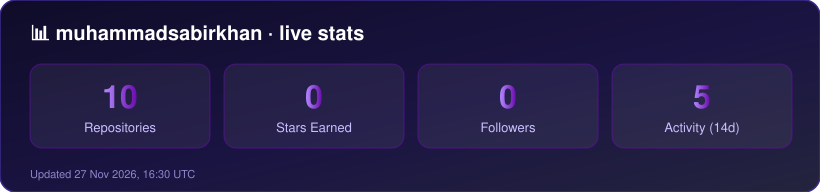
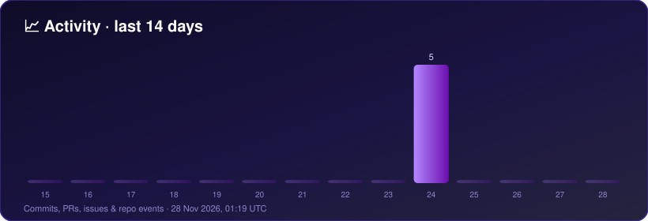
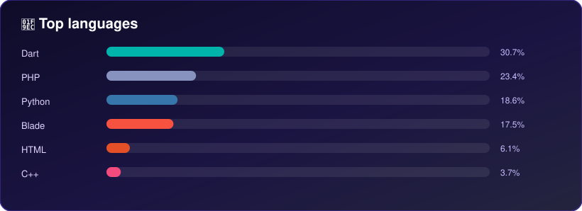

<!-- Banner -->

  

  

  
  
  
  

---

## ✨ About

I'm a **Software Engineering student** at COMSATS University Islamabad (Wah Campus) and an **AI-augmented developer**: I pair a solid full-stack foundation with modern AI tooling to design, build and ship faster.

- 🛍️ Building **[PrimeWear](https://github.com/muhammadsabirkhan/PrimeWear)**, a full-stack PHP e-commerce platform for clothing brands
- 🧠 Final-year project: **NeuroStride**, a Flutter app for neurodivergent individuals
- 🌱 Currently deepening **Laravel** and **advanced Flutter**
- 💬 Ask me about **PHP, Flutter, MySQL, E-Commerce, AI-assisted workflows**
- 📫 **muhammadsabirkhan407@gmail.com**

---

## 📡 Live Dashboard

<i>Auto-generated by GitHub Actions every 6 hours and on every push.</i>

  

  

  

### 🔥 Latest Activity

<!--RECENT_ACTIVITY:START-->
- ⬆️ Pushed **1** commit to [muhammadsabirkhan/muhammadsabirkhan](https://github.com/muhammadsabirkhan/muhammadsabirkhan) · `2026-11-24`
- ⬆️ Pushed **1** commit to [muhammadsabirkhan/muhammadsabirkhan](https://github.com/muhammadsabirkhan/muhammadsabirkhan) · `2026-11-24`
- ⬆️ Pushed **1** commit to [muhammadsabirkhan/muhammadsabirkhan](https://github.com/muhammadsabirkhan/muhammadsabirkhan) · `2026-11-24`
- ⬆️ Pushed **1** commit to [muhammadsabirkhan/muhammadsabirkhan](https://github.com/muhammadsabirkhan/muhammadsabirkhan) · `2026-11-24`
- ⬆️ Pushed **1** commit to [muhammadsabirkhan/muhammadsabirkhan](https://github.com/muhammadsabirkhan/muhammadsabirkhan) · `2026-11-24`
- 🐛 Opened an issue in [Stremio/stremio-features](https://github.com/Stremio/stremio-features) · `2026-11-05`

Last updated: 27 Nov 2026, 01:40 UTC
<!--RECENT_ACTIVITY:END-->

---

## 🧰 Tech Stack

  
  
  
  
  
  
  
  
  
  

---

## 📌 Featured Projects

<table>
  <tr>
    <td width="50%" valign="top">
      <h3>🛍️ <a href="https://github.com/muhammadsabirkhan/PrimeWear">PrimeWear</a></h3>
      
Complete e-commerce platform for clothing brands: products, inventory, pricing, orders and customer experience in one place.

      
      
      
    </td>
    <td width="50%" valign="top">
      <h3>🧠 NeuroStride</h3>
      
Final-year project: a Flutter mobile app designed to support neurodivergent individuals in daily life.

      
      
    </td>
  </tr>
</table>

---

## 🌐 Connect

  
  

  

